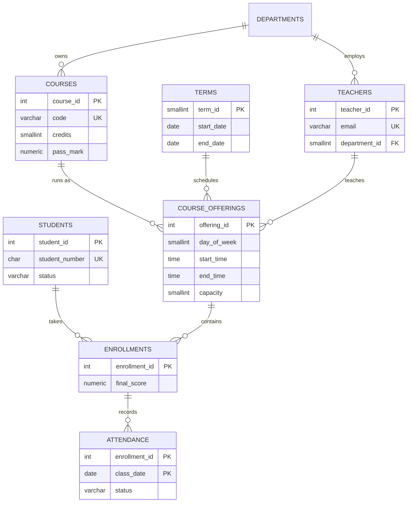

# School Management Database

A PostgreSQL database for running a secondary school: students, teachers, courses, timetables, enrollments, grades and attendance. It includes realistic sample data and 12 reporting queries that answer questions a school administrator would ask.

**Skills shown:** relational design and normalization, constraints and foreign keys, PL/pgSQL triggers, SQL functions, views, CTEs, window functions (`RANK`, `DENSE_RANK`, `LAG`), `FILTER` aggregates, anti-joins, and reproducible data generation.

## Data model



A **course** is the catalogue entry (e.g. MATH101). A **course offering** is that course taught in a specific term, by a specific teacher, in a room, at a time. Students enroll in offerings, not courses, so the same course can be taken again in a later term.

### Business rules enforced by the database

| Rule | How |
|---|---|
| A class cannot exceed its capacity | `trg_enrollments_capacity` trigger (locks the offering row to stay correct under concurrent enrollments) |
| A teacher cannot be double-booked | `trg_offerings_teacher_schedule` trigger using `OVERLAPS` |
| Scores are 0–100, classes end after they start, terms end after they begin | `CHECK` constraints |
| A student enrolls in an offering at most once; a course runs once per term | `UNIQUE` constraints |
| Grades and GPA are calculated the same way everywhere | `letter_grade()` and `grade_points()` functions |

## Project structure

```
sql/
  01_schema.sql              tables, constraints, indexes
  02_functions_triggers.sql  grading functions and business-rule triggers
  03_seed.sql                sample data (48 students, 6 terms, ~1,100 enrollments, ~12,600 attendance records)
  04_views.sql               transcript, GPA, attendance and timetable views
  05_queries.sql             12 reporting queries
setup.sh                     builds everything from scratch
```

## Getting started

Requires PostgreSQL 14+.

```bash
./setup.sh
```

```bash
psql -d school_db -f sql/05_queries.sql
```

`setup.sh` uses the standard `PGHOST` / `PGPORT` / `PGUSER` variables, so for a server on another port run `PGPORT=5433 ./setup.sh`. Re-running it rebuilds the `school` schema from scratch.

The sample data uses a fixed random seed, so every build produces identical data. It is a snapshot as of 6 November 2026: five terms are graded and *2026 Term 3* is in progress.

## Reporting queries

| # | Question | Techniques |
|---|---|---|
| Q1 | How full is each class this term? | view, arithmetic |
| Q2 | Pass rate, average and grade distribution per course | `COUNT(*) FILTER` |
| Q3 | Top 3 students per course last term | CTE, `DENSE_RANK` |
| Q4 | Honour roll (GPA ≥ 3.0) | credit-weighted GPA view, `RANK` |
| Q5 | Is each student improving term over term? | `LAG`, named `WINDOW` |
| Q6 | Does attendance affect results? | `CASE` banding, aggregates |
| Q7 | Which students are at risk right now? | CTEs, `string_agg ... FILTER`, `LEFT JOIN` |
| Q8 | Teacher workload (including teachers with no classes) | pre-aggregated CTE + `LEFT JOIN` |
| Q9 | Department performance by year | multi-table join, `GROUP BY` |
| Q10 | Courses failed and not yet passed | `NOT EXISTS` anti-join |
| Q11 | Active students not enrolled this term | `NOT EXISTS` |
| Q12 | Data check: double-booked rooms | self-join, `OVERLAPS` |

### Sample results

**Q2: Course pass rates.** Statistics and Physics have the most failures; French has the lowest pass rate because its pass mark is 60.

```
 course_code | graded | avg_score | pass_rate_pct |  a |  b |  c |  d |  f
-------------+--------+-----------+---------------+----+----+----+----+----
 FRE101      |     84 |      64.4 |          57.1 | 14 | 18 | 16 | 21 | 15
 MATH201     |     84 |      61.2 |          69.0 | 13 | 10 | 22 | 13 | 26
 PHYS101     |     95 |      62.7 |          69.5 | 20 | 12 | 15 | 19 | 29
 ...
 BIO101      |    101 |      68.7 |          92.1 | 28 | 17 | 26 | 22 |  8
```

**Q6: Attendance vs. results.** Students with perfect attendance score about 9 points higher on average than everyone else.

```
 attendance_band | enrollments | avg_score | fail_rate_pct
-----------------+-------------+-----------+---------------
 1. 100%         |         444 |      72.6 |          13.3
 2. 90-99%       |         312 |      63.2 |          25.0
 3. 80-89%       |         104 |      59.5 |          30.8
 4. below 80%    |          32 |      61.6 |          21.9
```

**Q8: Teacher workload.** The new hire with no classes still appears, thanks to the `LEFT JOIN`.

```
      teacher      |    department    | classes | students | hours_per_week
-------------------+------------------+---------+----------+----------------
 Baraka Otieno     | Languages        |       2 |       46 |            4.0
 Jean Habimana     | Mathematics      |       2 |       45 |            4.0
 ...
 Sarah Ingabire    | Mathematics      |       0 |        0 |              0
```

## Possible extensions

- Prerequisites between courses, enforced on enrollment
- Guardians/parents table and a contact report for at-risk students
- Row-level security so teachers only see their own classes
- A small dashboard (e.g. Metabase or Streamlit) on top of the views
